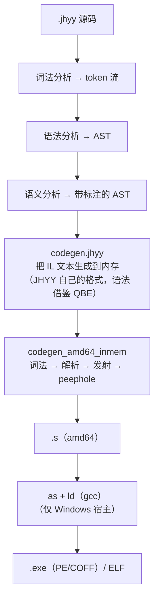

# 架构

编译器是怎么搭起来的，以及为什么自举闭环是整个设计的中心。

仓内的文档是
[docs/internal/architecture.md](https://github.com/JiHuiYiYou/JiHuiYiYou-compiler/blob/main/docs/internal/architecture.md)；
这一页是导览版。

---

## 流水线



每个阶段都是用 JHYY 写的。树里没有 C 的 bootstrap 编译器——编译编译器的那个编译器，
就是编译器本身。

---

## 自举闭环

这是这个项目最不寻常的部分，所以有必要把它**证明了什么**和**没证明什么**说准。

```
   src0/*.jhyy  ──被编译──▶  jhyy.exe  （第 1 代）
                                   │
                                   └──被编译──▶  jhyy.exe  （第 2 代）
                                                        │
                                                        └── .s 逐字节相同？ ──▶ 是 ⇒ 不动点
```

`make` 一直迭代这个循环，直到连续两代产出**逐字节相同**的汇编。三条推论要分清：

- **不动点是跑出来的，不是假设的。** 构建会一直迭代；它不会在第 2 代就停下然后祈祷。
- **它证明的是确定性，不是正确性。** 一个确定性的**错误**编译器也能完美闭环。这就是
  经典的 "trusting trust" 缺口。语义正确性由另一道门覆盖：回归套件。
- **这是发版级的性质。** 改编译器源码会移位模块级临时编号，让自举构建漂移——所以
  这类改动要牵动整套发版流程（回归套件、闭环刷新、产物刷新），而不只是重新编译。

---

## 中间表示

IL 是 **JHYY 自己的格式**。它借了 QBE 的**语法**做起点，但没有任何 QBE 代码被
vendored、链接或执行——QBE 整个从项目里移除了，自研后端是唯一的代码生成路径。

IL 生成到**内存**里而不是文件，而且刻意保持文本形态：可读、可 diff，出问题时容易
直接看。（`jhyy dump` 出于同样的理由打印解析后的 AST——在开发期能直接看中间形态，
值很多。）

---

## 后端

amd64 后端由一组职责单一的模块组成：

| 模块 | 职责 |
|---|---|
| `codegen_amd64_lexer` | 对 IL 文本做词法分析 |
| `codegen_amd64_state` | 发射器的状态机 |
| `codegen_amd64_emit_call` | 调用、实参、寄存器类别 |
| `codegen_amd64_emit_ctrl` | 分支、比较、控制流 |
| `codegen_amd64_emit_mem` | 载入、存储、寻址方式 |
| `codegen_amd64_emit_sse` | 浮点与 SSE |
| `codegen_amd64_peephole` | 对已发射汇编做 peephole 优化 |
| `codegen_amd64_rcache` | 寄存器缓存 |
| `codegen_amd64_regalloc` | 寄存器分配 |
| `codegen_amd64_xmm_argalloc` | 向量寄存器中的传参 |
| `codegen_amd64_inmem` | 把上面这些串起来的驱动 |

寄存器分配是当前的工作主线，它的落地位置在 **emit 层**：发射器直接消费寄存器，
而分配器的产出被要求在引入过程中保持生成代码逐字节不变。

---

## 目标三元组

| 三元组 | ABI | 说明 |
|---|---|---|
| `amd64_win` | x86-64-w64-mingw32 | 托管 Windows —— 默认 |
| `amd64_win_freestanding` | x86-64-w64-none | UEFI，无操作系统 |
| `amd64_sysv` | x86-64-linux-none | Linux SysV ABI |
| `amd64_sysv_freestanding` | x86-64-linux-none-freestanding | 静态，无 libc |

三个非默认目标只产出 `.s`——自带的链接器是 Windows 链接器，用它链一个外来 ABI
会产出在第一次 libc 调用就崩的二进制。所以编译器现在**拒绝**链接交叉目标：
加 `--no-link`，自己用匹配的工具链链。

---

## 运行时

| 部件 | 职责 |
|---|---|
| `compiler/runtime/runtime.c` | C 支撑库 —— arena 分配器，以及 `main` → `main_jhyy` 的桥接 |
| `compiler/runtime/no_std_core/` | `no_std` 目标用的 freestanding 核心 |
| `runtime/linux_elf/` | `crt0.S` + `link.ld` —— 静态、无 libc 的 Linux ELF 运行时 |

运行时刻意做得很小：一门自带大型托管运行时的语言就不是系统语言。计划是用纯 JHYY
替换掉剩下的那部分 C 支撑库。

---

## 源码布局

```
compiler/
├── src0/                     编译器 —— 唯一的实现
│   ├── std/                  标准库（mem / fmt / io / math / string / vec / os / arena）
│   └── codegen_amd64_*.jhyy  自研后端
├── runtime/                  C 支撑库 + freestanding 核心
├── tests/
│   ├── examples/             回归用例，由 regress.py 驱动
│   └── bootstrap/            闭环 / 不动点 / 产物检查脚本
└── build/bin/                编出来的编译器与它的自举副本

runtime/linux_elf/            Linux ELF 运行时（crt0.S + link.ld）
bench/                        基准套件与测量口径
regress.py                    回归驱动（仓库根）
mcp-jhyy/                     给 AI 编码助手的 MCP 服务
vscode-ext/                   VS Code 扩展
installer/                    Windows 安装器与内置工具链
docs/                         规范、仓内文档、计划、变更日志
```

---

## 接下来

- [[构建与测试]] —— 构建、测试、那些门。
- [[常见问题]] —— 关于设计的疑问。
- [架构速览（仓内）](https://github.com/JiHuiYiYou/JiHuiYiYou-compiler/blob/main/docs/internal/architecture.md)
  —— 详细版，含模块依赖图。
