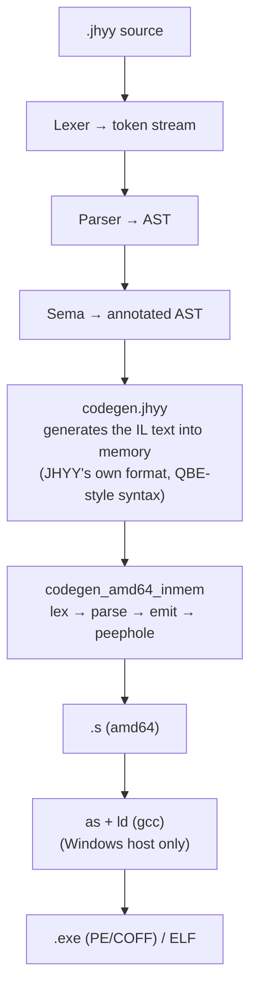

# Architecture

How the compiler is put together, and why the self-hosted closed loop sits at the
center of the whole design.

The in-repository document is
[docs/internal/architecture.md](https://github.com/JiHuiYiYou/JiHuiYiYou-compiler/blob/main/docs/internal/architecture.md);
this page is the guided tour version.

---

## Pipeline



Every stage is written in JHYY. There is no C bootstrap compiler in the tree — the
compiler that compiles the compiler is the compiler itself.

---

## The self-hosting closed loop

This is the most unusual part of the project, so it is worth stating precisely **what
it proves** and **what it does not prove**.

```
   src0/*.jhyy  ──compiled──▶  jhyy.exe  (generation 1)
                                   │
                                   └──compiled──▶  jhyy.exe  (generation 2)
                                                        │
                                                        └── .s byte-identical? ──▶ yes ⇒ fixed point
```

`make` keeps iterating this loop until two consecutive generations produce
**byte-identical** assembly. Three consequences have to be kept apart:

- **The fixed point is run, not assumed.** The build keeps iterating; it does not stop
  at generation 2 and then hope for the best.
- **What it proves is determinism, not correctness.** A deterministic **wrong**
  compiler can close the loop perfectly. This is the classic "trusting trust" gap.
  Semantic correctness is covered by a different gate: the regression suite.
- **This is a release-grade property.** Changing compiler source shifts module-level
  temporary numbering and makes the self-hosted build drift — so such a change has to
  pull the whole release process along (regression suite, closed-loop refresh, artifact
  refresh), not just a recompile.

---

## Intermediate representation

The IL is **JHYY's own format**. It borrowed QBE's **syntax** as a starting point, but
no QBE code is vendored, linked, or executed — QBE was removed from the project
entirely, and the self-written backend is the only code generation path.

The IL is generated into **memory** rather than into a file, and deliberately keeps a
textual shape: readable, diffable, and easy to look at directly when something goes
wrong. (`jhyy dump` prints the parsed AST for the same reason — during development,
being able to look at the intermediate shape directly is worth a lot.)

---

## Backend

The amd64 backend is made of a set of single-responsibility modules:

| Module | Responsibility |
|---|---|
| `codegen_amd64_lexer` | Lex the IL text |
| `codegen_amd64_state` | The emitter's state machine |
| `codegen_amd64_emit_call` | Calls, arguments, register classes |
| `codegen_amd64_emit_ctrl` | Branches, comparisons, control flow |
| `codegen_amd64_emit_mem` | Loads, stores, addressing modes |
| `codegen_amd64_emit_sse` | Floating point and SSE |
| `codegen_amd64_peephole` | Peephole optimization over the already emitted assembly |
| `codegen_amd64_rcache` | Register cache |
| `codegen_amd64_regalloc` | Register allocation |
| `codegen_amd64_xmm_argalloc` | Argument passing in vector registers |
| `codegen_amd64_inmem` | The driver that ties all of the above together |

Register allocation is the current main line of work, and it lands at the **emit
layer**: the emitter consumes registers directly, while the allocator's output is
required to keep the generated code byte-identical as it is brought in.

---

## Target triples

| Triple | ABI | Notes |
|---|---|---|
| `amd64_win` | x86-64-w64-mingw32 | hosted Windows — the default |
| `amd64_win_freestanding` | x86-64-w64-none | UEFI, no operating system |
| `amd64_sysv` | x86-64-linux-none | Linux SysV ABI |
| `amd64_sysv_freestanding` | x86-64-linux-none-freestanding | static, no libc |

The three non-default targets only produce `.s` — the bundled linker is the Windows
linker, and using it to link a foreign ABI produces a binary that crashes on its first
libc call. So the compiler now **refuses** to link cross targets: add `--no-link` and
link it yourself with a matching toolchain.

---

## Runtime

| Piece | Responsibility |
|---|---|
| `compiler/runtime/runtime.c` | C support library — the arena allocator, and the `main` → `main_jhyy` bridge |
| `compiler/runtime/no_std_core/` | The freestanding core for `no_std` targets |
| `runtime/linux_elf/` | `crt0.S` + `link.ld` — a static, libc-free Linux ELF runtime |

The runtime is deliberately tiny: a language that ships with a large managed runtime is
not a systems language. The plan is to replace the remaining part of the C support
library with pure JHYY.

---

## Source layout

```
compiler/
├── src0/                     the compiler — the only implementation
│   ├── std/                  standard library (mem / fmt / io / math / string / vec / os / arena)
│   └── codegen_amd64_*.jhyy  self-written backend
├── runtime/                  C support library + freestanding core
├── tests/
│   ├── examples/             regression cases, driven by regress.py
│   └── bootstrap/            closure / fixed point / artifact check scripts
└── build/bin/                the compiled compiler and its self-hosted copy

runtime/linux_elf/            Linux ELF runtime (crt0.S + link.ld)
bench/                        benchmark suite and measurement methodology
regress.py                    the regression driver (repository root)
mcp-jhyy/                     the MCP service for AI coding assistants
vscode-ext/                   VS Code extension
installer/                    Windows installer and bundled toolchain
docs/                         specs, in-repo documents, plans, changelog
```

---

## Next

- [[Build-and-Test]] — building, testing, and the gates.
- [[FAQ]] — questions about the design.
- [Architecture overview (in the repository)](https://github.com/JiHuiYiYou/JiHuiYiYou-compiler/blob/main/docs/internal/architecture.md)
  — the detailed version, with a module dependency graph.
